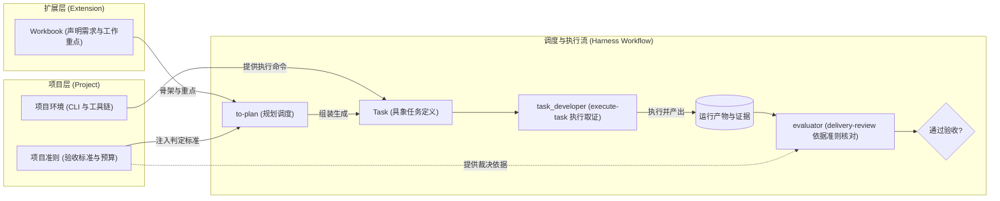

# 扩展 Workbook 接入具体项目的解耦与协同架构

决策日期：2026 年 10 月 30 日。

## 目的与背景

随着工具包向垂直领域持续演进，各类扩展（如 `game` 扩展及其上层封装 `game-programming-development`，以及未来可能建立的音视频、网络通讯、仿真模拟等扩展）在通用开发流程之上定义了丰富的特化任务类型（如规则装填、视听表现装配、调试支撑、渲染专项）。这些特化任务需要产出专精的验证依据（确定性断言、交互录屏、秒级复现场景、DrawCall 与帧耗时预算等）。

然而，具体业务项目的技术栈与工程基础设施存在巨大差异（如游戏工程可能基于 Godot、Unity、Unreal 或自研 C++ 引擎；其日志系统、自动化测试 Runner、性能分析与抓帧可观测性堆栈各不相同）。若在扩展 Workbook 中直接硬编码特定引擎命令、私有分析工具或固定日志路径，将破坏扩展跨技术栈的通用性与普适性；反之，若完全缺失取证与验收约束，执行与审核角色将失去明确的交付与裁决抓手。

此外，在探索初期曾设想在 Workbook 中显式定义“证据插槽契约（Evidence Slots）”作为具象实体供调度器解析，但经实践审视，这会在规划期引入不必要的实体与管理摩擦，违背“如无必要、勿增实体”的底层原则。必须确立一套既能保持扩展高度通用，又能让具体项目灵活提供可观测性支撑的协同模式。

## 核心选择

确立 **“扩展声明关注重点，项目落地准则与工具”** 的控制反转（IoC）与关注点分离（SoC）架构：

1. **扩展层职责：关注点与工作重点声明**
   - 扩展 Workbook 专注于描述任务阶段切分、关注重点、输入依据与下游交接价值。
   - 严禁在扩展 Workbook 中硬编码特定引擎命令、私有工具调用或特定输出路径，保持纯粹的跨项目通用方法身份。
2. **项目层职责：准则自建与工具自备**
   - 具体项目享有完全的架构自主权，按需在项目内部维护：
     - **项目自建准则 (Project Principles)**：定义项目特有的判定标准与预算阈值（如平台帧率底线、DrawCall 上限、状态机断言规范等）。准则的命名、目录划分与 scope 管理完全由项目开发者自定。
     - **可执行工具链 (Project Tools / Scripts)**：提供方便 Agent 或开发者一键调用的取证脚本或命令（如无头测试运行器、Gym 场景入口、性能采样与抓帧工具），并在项目 `AGENTS.md` 中给出明确调用入口。
3. **调度编排层职责：自然注入与闭环驱动**
   - `to-plan` 规制任务时聚焦业务分解，无需识别抽象的插槽实体对象。结合项目 `AGENTS.md` 的指引，将项目自备的验收准则与一键命令自然注入到生成的 `task.md`。
   - 执行角色（`task_developer` / `execute-task`）根据注入的命令执行并抓取证据；审核角色（`evaluator` / `delivery-review`）对照注入的原则指标对交付物进行合格性裁决。
4. **实施落地准则：渐进式取证（如无必要，勿增实体）**
   - 证据要求应与项目的研发阶段阶梯式匹配：白盒原型期（Tier 1：基础断言日志/截图） -> 功能演化期（Tier 2：自动化测试套件/Gym 场景） -> 生产调优期（Tier 3：完整帧抓取与性能预算分析），避免轻量原型陷入重度基础设施的过度设计。

## 协同调度架构全景

## 实施取舍

- **Workbook 极简表达**：取消原本构想的独立“证据插槽契约”章节与专有实体定义，将验证关注点与下游用途提炼后直接融入 Workbook 的 Task 职责分流表格，使 Workbook 保持精简实用。
- **高层设计理念归位**：将“证据插槽理念（Evidence Slots Pattern）”作为扩展层的高层架构哲学收录于扩展 `README.md` 中，指导未来扩展的架构设计。
- **完全解耦引擎与工具链**：扩展层无需为每种引擎（Godot/Unity/Unreal/自研）编写专有变体 Workbook，所有具体命令由各项目环境自解释。

## 承受的代价

- **依赖项目工程基建质量**：若具体项目未在 `AGENTS.md` 或脚本中提供标准化、低心智负担的取证工具，Agent 在执行任务时可能需要临时摸索引擎参数，取证效率受项目基建完备度制约。
- **依赖规划期的指引注入**：由于未引入机器级别的插槽类型系统强校验，项目原则与命令的注入依赖 `to-plan` 遵循项目 `AGENTS.md` 的规范指引，依靠流程约定而非类型编译器保障。

## 依据与承接

依据 2026 年 10 月 30 日关于 `game-programming-development` 上层封装接入具体项目的架构讨论与实装。本决策作为后续开发更多领域扩展、设计新 Workbook 时的统一通用性与普适性设计指引。
