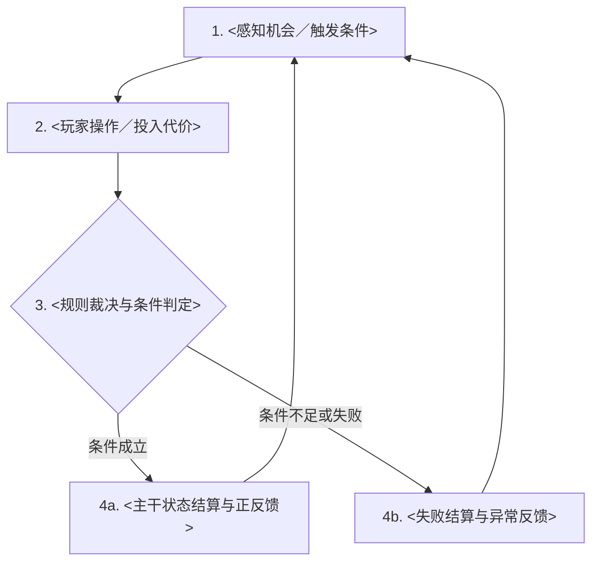

# <玩法名称>

<!-- 按 ../../references/gameplay-spec.md 编写，按实际设计取用章节并删除模板注释。研究草稿标明候选性质；正式定稿由工具维护身份。 -->

## 目标与组合边界

- **玩家目标与体验**：
- **负责范围**：

### 直接组合关系

<!-- 列出直接使用的正式 Spec，说明原机制职责与本 Spec 新增互动。基础机制可省略本节。 -->

| Artifact ID | 承担职责 | 本 Spec 的组合约束或新增互动 |
| --- | --- | --- |
| `<真实 Artifact ID>` |  |  |

## 术语、实体与状态

<!-- 声明本玩法新增的专有术语、实体、状态合法值域、操作标识与共享范围；复用上游定义时注明来源。 -->

| 标识 | 类型 | 定义、合法值域与共享范围 |
| --- | --- | --- |
| `<Identifier>` | `Term`／`Entity`／`State`／`Operation` |  |

### 状态约束与不变式

<!-- 描述在适用范围内始终成立的状态关系、容量上限或派生值计算规则。无跨步骤约束时可省略。 -->

- `R-01`：

## 核心内循环

<!-- 用 3–5 个紧凑步骤表达从感知、输入、规则裁决、状态结算到反馈并塑造后续决策的完整回路。 -->

### 1. `<步骤名称>`

- **触发与输入**：<!-- 环境触发条件，或玩家 Operation 意图与影响玩法的输入语义（如 press、hold、release）。 -->
- **规则与结算**：
  - `R-02`：<!-- 前置条件、作用对象与同次结算的全部状态变化。 -->
  - **失败与边界**：<!-- 条件不足或失败时的实际结果（保持不变、部分消耗或分支惩罚），以及阈值、顺序或重复触发边界。 -->
- **互动反馈**：
  - `F-01`：<!-- 玩家获知的信息内容、出现时机，以及影响决策或结算的持续与结束条件。 -->

<!-- 按内循环实际步骤依次展开；具体键位与 HUD 布局引用 DESIGN.md，画面、镜头与特效引用 docs/GAME-VISUALS.md。 -->

## 验收标准

- 在<必要初始状态与输入条件>下，<本 Spec 负责的核心结算结果、状态约束或失败边界>成立（对应 `R-xx`、`F-xx`）。
