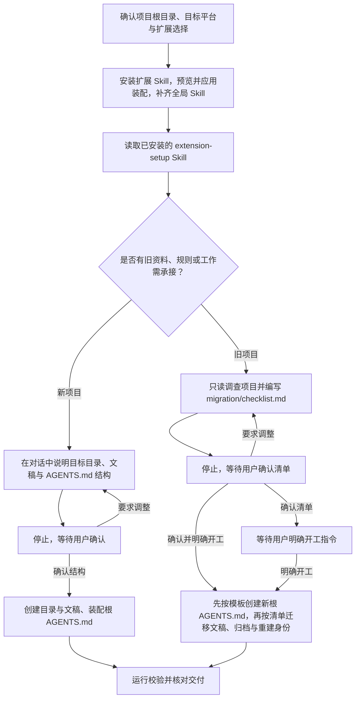

# 项目初始化与迁移

## 适用与输入

默认以当前仓库路径为项目根目录（新项目可指定待建目录），确认目标 harness 平台（Codex、Claude、Pi）、所选扩展与接入范围。按是否有旧资料、规则、架构成果或旧安装记录需承接选择分支；已有工程首次接入按旧项目迁移处理。四个公共 CLI 的业务命令均在项目根目录执行。

开始前读取[安装说明](references/installation.md)与[项目文档](references/project-docs.md)；旧项目另读[迁移说明](references/migration.md)。

## 必要工作流程

1. **确认输入与项目现状**。核对项目根目录、目标平台与扩展列表。全新项目在已确认的位置创建空目录。核对是否有既有文档、旧版 `.agents/harness.json` 或退役运行状态；若存在需移档的旧运行状态，先停止相关写入并向用户确认项目内相对路径，按[安装说明](references/installation.md#旧运行状态归档)运行 `harness-install archive PATH...`。
2. **准备扩展并装配资源**。在创建或迁移项目结构与 `AGENTS.md` 之前，按[安装说明](references/installation.md#装配步骤)依次完成扩展安装、预览装配（向用户说明写入范围、目标平台及可能补齐的全局 Skill）并经确认后应用装配，生成 `.agents/extensions/<extension>/` 快照、所选平台 adapter 与 `.agents/harness.json`。
3. **读取已安装 setup**：若启用了扩展，读取已安装的 `extension-setup-<extension>/SKILL.md` 及正文按步骤引用的配套资料，确定项目适用的文档路径、目录结构、领域迁移项与验收要求。
4. **按新旧项目分支推进**：
   - **新项目**：在对话中说明最终结构（目标目录、基础与领域文档、根 `AGENTS.md`、已装配扩展与平台入口）。用户确认结构后，按[项目文档](references/project-docs.md)置入 `.gitignore`、`.ignore`、`.rgignore`、创建文档与目录并装配根 `AGENTS.md`。
   - **旧项目**：按[迁移说明](references/migration.md)只读调查项目现状并结合 setup 要求编写 `migration/checklist.md`。确认清单不等于开工；取得清单确认与明确开工指令后（可在同一回复中一并给出），先按[项目文档](references/project-docs.md)基于模板创建并启用新根 `AGENTS.md`，再执行正式文稿与目录迁移、退役文稿归档与成果身份重建。
5. **校验与交付**：运行 `handbook validate` 与 `project-state validate`，对引用的正式成果用 `project-state locate` 核对活动正文可达；核对 `AGENTS.md` 导航与实际文件一致（旧项目收敛临时说明并更新清单完成标记），最终交付成果摘要及未验证范围。

## 工序切分与交接

首次接入与状态重建由当前 Agent 经 `toolkit-steward` 顺序推进，不创建接入 Plan 或拆分 Task。旧项目调查发现的后续开发目标、待审原则草稿与未完分支，按真实状态整理后交由项目后续独立规划承接。

## 产出与验收

交付根 `AGENTS.md`、基础与领域正式文稿、`.agents/harness.json`、所选扩展快照与平台 adapter。迁移项目另交付 `migration/` 清单、归档对应关系与未完目标接管位置。

- 运行 `handbook validate` 与 `project-state validate`，确认均通过校验。
- 核对根 `AGENTS.md` 保留“公共工具与项目配置”中的固定文案，且导航指向实际存在的路径。
- 核对旧运行状态与退役文稿按已确认范围归档，原有有效内容与延续成果身份完整承接。
