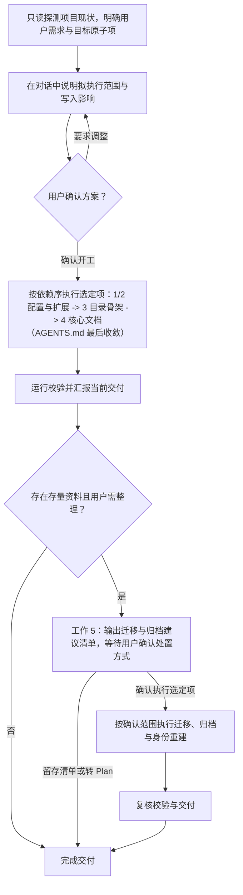

# 项目配置与接入

## 适用与输入

适用于任意项目的 Trigrams toolkit 接入、配置修复、扩展增删同步、骨架文档维护与存量资料整理，不按新旧项目切分固定路径。默认以当前仓库路径为项目根目录（全新项目可指定待建目录）；四个公共 CLI 的业务命令均在项目根目录执行。

按本次选用的原子工作按需读取参考说明：

- 工作 1、2：[Harness 装配与扩展管理](references/harness-and-extensions.md)
- 工作 3、4：[目录与项目文档](references/project-docs.md)
- 工作 5：[存量迁移与归档](references/migration.md)

## 原子工作目录

以下 5 项工作相互独立，可单独指定执行，也可按需组合：

| 编号 | 原子工作 | 职责范围 |
| --- | --- | --- |
| 1 | **基础配置与资源核对** | 核对并修复 `.agents/harness.json`、平台 adapter 与全局依赖；按需归档旧运行状态；合并根忽略文件（`.gitignore`、`.ignore`、`.rgignore`）；核对已有或按需创建的 `docs/resources.json` 与扩展资源结构 |
| 2 | **扩展管理** | 安装、增补、升级同步或移除扩展 Skill 与 `.agents/extensions/<extension>/` 快照；直接从项目 Skill 目录读取 `extension-setup-<extension>/SKILL.md` 获取领域约定 |
| 3 | **目录骨架搭建** | 核对并按需建立 `docs/` 标准目录（缺失需预留的决策、复盘、Plan 等目录放入 `.gitkeep`）及扩展约定的领域目录 |
| 4 | **项目级核心文档维护** | 按需创建或更新 `PRODUCT.md`、`DEVTECH.md`、`DESIGN.md`、`AGENTS.md`（使用 Claude 时同步根 `CLAUDE.md`）；`docs/ARD.md` 仅按需创建空占位文件 |
| 5 | **存量迁移与归档清单** | 后置可选：基于项目现状产出建议的核心内容迁移、归档与身份重建清单；按用户意愿决定留存清单、执行全部／部分条目或转后续 Plan |

## 整体工作流程

1. **调查现状并确认方案**：只读检查项目根目录、`.agents/harness.json`、现有目录与文档，明确用户本次想做的原子项、目标 `agent`／`platforms` 与扩展列表。在对话中列出拟执行的原子项与预期改动范围，**等待用户确认后再修改文件**。
2. **按依赖顺序执行已确认项**（跳过未选中的项）：
   - **工作 1 与工作 2（配置与扩展）**：按[Harness 装配与扩展管理](references/harness-and-extensions.md)归档需替换的旧运行状态，安装或调整扩展 Skill，经 `harness-install install preview` 确认写入范围后运行 `apply` 收敛 `.agents/harness.json`、adapter 与扩展快照；启用扩展时，直接按路径读取 `.agents/skills/extension-setup-<extension>/SKILL.md`（Claude Code 同步检查 `.claude/skills/`）收集领域目录、文档与术语约定；核对根忽略文件与已有 `docs/resources.json`。
   - **工作 3（目录骨架）**：按[目录与项目文档](references/project-docs.md#工作-3目录骨架搭建)补齐所选 `docs/` 目录与扩展领域目录，需预留的空目录放入 `.gitkeep`。
   - **工作 4（项目级核心文档）**：按[目录与项目文档](references/project-docs.md#工作-4项目级核心文档维护)创建或增量更新所选的 `PRODUCT.md`、`DEVTECH.md`、`DESIGN.md`、`AGENTS.md`；选中 `docs/ARD.md` 时仅建空占位文件。多项同时执行时，`AGENTS.md` 在最后收敛，确保导航与实际路径、已启用扩展一致。
3. **校验与汇报**：运行 `handbook validate`；若项目已启用 `.project-state/state.json`，运行 `project-state validate`。核对本次改动符合已确认范围，汇报结果与未执行项。
4. **后置按需：工作 5（存量迁移与归档）**：基础结构完成后，若发现存量散落文档、旧 Spec 或旧状态且用户有整理意图，按[存量迁移与归档](references/migration.md)编写建议清单并等待确认，由用户决定是否执行或拆出后续 Plan。

## 工序切分与交接

项目配置、扩展管理、骨架搭建与基础文档维护由当前 Agent 直接顺序完成，不创建接入 Plan。工作 5 清单中识别出的长期研发目标、待审原则草稿或大范围架构迁移，交由项目后续独立 Plan 或 `architect` 等专用 Skill 承接。

## 产出与验收

仅核对本次实际执行的原子项：

- **工作 1／2**：`.agents/harness.json`、所选扩展快照与平台 adapter 符合确认结果，`handbook validate` 通过。
- **工作 3**：选定目录结构完整，预留空目录包含 `.gitkeep`，无多余占位正文。
- **工作 4**：所选核心文档符合项目事实，`AGENTS.md` 保留“公共工具与项目配置”固定文案，所有导航路径真实存在。
- **工作 5**：产出清晰的迁移与归档建议清单；若用户确认执行，核对 `project-state validate` 与 `project-state locate <Artifact ID>` 通过且归档原件可查。
