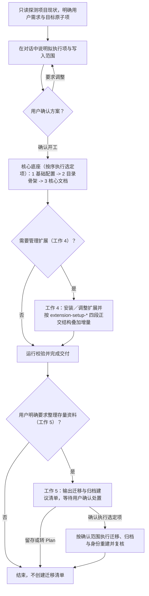

# 项目配置与接入

## 适用与输入

适用于任意项目的 Trigrams toolkit 配置核对、骨架与核心文档搭建、扩展管理及存量资料整理，不按新旧项目切分固定路径。默认以当前仓库路径为项目根目录（全新项目可指定待建目录）。

按本次选用的原子工作按需读取参考说明：

- 工作 1：[基础配置与资源核对](references/core-config.md)
- 工作 2、3：[目录与项目文档](references/project-docs.md)
- 工作 4（可选）：[扩展管理](references/extensions.md)
- 工作 5（仅用户明确要求时）：[存量迁移与归档](references/migration.md)

## 原子工作目录

5 项工作相互独立，可单独指定执行，也可按需组合。其中**工作 1–3 为项目核心底座**，**工作 4 为叠加在核心底座之上的可选扩展层**，**工作 5 仅在用户明确要求时启动**：

| 编号 | 分层 | 原子工作 | 职责范围 |
| --- | --- | --- | --- |
| 1 | 核心 | **基础配置与资源核对** | 核对并修复 `.agents/harness.json`、平台 adapter 与全局依赖；按需归档旧运行状态；合并根忽略文件（`.gitignore`、`.ignore`、`.rgignore`）；核对已有或按需创建的 `docs/resources.json` 与资源校验 |
| 2 | 核心 | **目录骨架搭建** | 核对并按需建立 `docs/` 标准目录（决策、复盘、Plan 等缺失需预留目录放入 `.gitkeep`） |
| 3 | 核心 | **项目级核心文档维护** | 按需创建或更新 `PRODUCT.md`、`DEVTECH.md`、`DESIGN.md`、`AGENTS.md`（使用 Claude 时同步根 `CLAUDE.md`）；`docs/ARD.md` 仅按需创建空占位文件 |
| 4 | 可选 | **扩展管理** | 在核心底座就绪后，按需安装、增补、同步或移除扩展 Skill 与 `.agents/extensions/<extension>/` 快照，按项目路径读取 `extension-setup-<extension>/SKILL.md` 并按其四段正交结构叠加增量 |
| 5 | 显式 | **存量迁移与归档清单** | 仅用户明确要求时执行：结合项目现状与已启用扩展的迁移建议产出 `migration/checklist.md`，按用户决定留存、部分／全部执行或转后续 Plan |

## 必要工作流程

1. **探测现状并确认方案**：只读检查项目根目录、`.agents/harness.json`、现有目录与核心文档，结合用户需求明确本次要执行的原子项、目标 `agent`／`platforms` 与是否启用扩展。在对话中说明拟执行内容与写入范围，**等待用户确认后再修改文件**。
2. **完成核心底座（工作 1 → 2 → 3，跳过未选中的项）**：
   - **工作 1**：按[基础配置与资源核对](references/core-config.md)归档需替换的旧运行状态，经 `harness-install install preview → apply` 收敛 `.agents/harness.json` 与平台 adapter，合并根忽略文件并核对已有 `docs/resources.json`。
   - **工作 2**：按[目录与项目文档](references/project-docs.md#工作-2目录骨架搭建)补齐 `docs/` 标准骨架，需预留的空目录放入 `.gitkeep`。
   - **工作 3**：按[目录与项目文档](references/project-docs.md#工作-3项目级核心文档维护)新建或增量更新所选核心文档（`docs/ARD.md` 若选中仅建空占位文件），收敛 `AGENTS.md`（及 Claude 下的 `CLAUDE.md`）。
3. **按需执行工作 4（扩展管理）**：仅当用户要求安装、增补、同步或移除扩展时，按[扩展管理](references/extensions.md)在核心底座上叠加扩展。若独立调用工作 4 时核心底座尚未就绪，先补齐必需的工作 1–3 再叠加扩展。
4. **校验与交付**：运行 `handbook validate`（存在 `.project-state/state.json` 时同步运行 `project-state validate`），核对 `AGENTS.md` 路径真实存在，向用户汇报交付结果。**无用户明确要求时，到此结束，不主动扫描存量资料或创建迁移清单。**
5. **显式触发工作 5（存量迁移与归档清单）**：仅当用户明确提出整理存量资料、归档旧文档或生成迁移清单时，按[存量迁移与归档](references/migration.md)汇总核心与已启用扩展的迁移建议，产出清单并等待用户确认处置方式。

## 工序切分与交接

工作 1–4 由当前 Agent 直接顺序完成，不创建接入 Plan。工作 5 清单中识别出的长期研发目标、待审原则草稿或大范围架构迁移，交由项目后续独立 Plan 或 `architect` 等专用 Skill 承接。

## 产出与验收

仅核对本次实际执行的原子项：

- **工作 1**：`.agents/harness.json` 与平台 adapter 符合确认结果，根忽略文件无冲突，`handbook validate` 通过。
- **工作 2**：选定 `docs/` 目录结构完整，预留空目录包含 `.gitkeep`，无多余占位正文。
- **工作 3**：所选核心文档符合项目事实，`AGENTS.md` 保留“公共工具与项目配置”固定文案，所有导航路径真实存在。
- **工作 4**：扩展快照与依赖检查通过，扩展目录、文档增量与 `AGENTS.md` 导航（含卸载清理）均与已启用扩展一致。
- **工作 5**：仅在用户明确要求时产出清单；若确认执行，核对 `project-state validate` 与 `project-state locate <Artifact ID>` 通过且归档原件可查。
